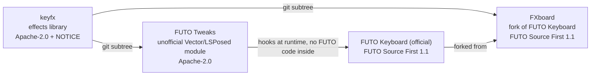

# FXboard: an FX keyboard, a fork of FUTO Keyboard

[](https://github.com/Theo-Erickson/fxboard/releases/latest)
[](LICENSE.md)

> [!IMPORTANT]
> **Unofficial, work in progress.** FXboard is an unofficial, modified version of [FUTO Keyboard](https://github.com/futo-org/android-keyboard). It is not made, endorsed or supported by FUTO. The official FUTO Keyboard is at [github.com/futo-org/android-keyboard](https://github.com/futo-org/android-keyboard) and [keyboard.futo.tech](https://keyboard.futo.tech/).
>
> Please report problems with FXboard [here](https://github.com/Theo-Erickson/fxboard/issues), not to FUTO.

**FXboard is FUTO Keyboard with keyboard effects and a few typing extras.** It keeps everything FUTO Keyboard does (offline, private, swipe typing, voice input, predictions that learn on your phone) and adds keypress effects, a vertical spacebar cursor, and an option to hide the navigation bar. No root needed.

<!-- Media: a GIF of FXboard's effects, e.g.  -->

## Contents

- [Summary](#summary)
- [Downloads](#downloads)
- [Install](#install)
- [What FXboard adds](#what-fxboard-adds)
- [Related projects](#related-projects)
- [FAQ](#faq)
- [How FXboard follows the FUTO license](#how-fxboard-follows-the-futo-license)
- [Supporting the work](#supporting-the-work)
- [Building from source](#building-from-source)
- [Credits](#credits)

## Summary

FUTO Keyboard is a good modern keyboard that stays offline and doesn't spy on you. FXboard is a fork of it that adds keypress effects and a few typing extras. Next up is [keyfx](https://github.com/Theo-Erickson/keyfx), a larger set of effects: key pops, floating letters, backspace fire and black holes, swipe trails, letter hop and more.

- **Everything FUTO Keyboard does**, unchanged: FXboard tracks FUTO's upstream code and adds to it.
- **Extras off by default.** Everything FXboard adds lives in Settings under **FXboard extras** and **Keyboard effects**, and every effect starts off.
- **Installs alongside the official app** as its own app (`com.theo.fxboard`), so you can try it without removing FUTO Keyboard.
- **Free.** No ads, no paid features, no donation button in the app.

Have root and prefer to keep the official FUTO app? [FUTO Tweaks](https://github.com/Theo-Erickson/futo-tweaks) adds most of the same extras to it as an LSPosed / Vector module.

## Downloads

| | |
|---|---|
| **Latest APK** | [Releases page](https://github.com/Theo-Erickson/fxboard/releases/latest), file `fxboard-<version>-r<N>.apk` |
| **All versions** | [All releases](https://github.com/Theo-Erickson/fxboard/releases) |
| **Source** | `git clone --recursive https://github.com/Theo-Erickson/fxboard.git` (see [Building from source](#building-from-source)) |

Official FXboard builds only come from this repository's [Releases](https://github.com/Theo-Erickson/fxboard/releases). GitHub Actions builds each one from the commit it names. Each one is signed with this key:

```
SHA-256: D6:26:CA:25:99:B1:13:EA:7E:11:6B:D4:E3:3F:F9:CA:89:5C:B7:88:2A:EF:42:1C:2D:B0:BB:FF:D2:92:B5:2C
```

A keyboard sees everything you type, so please don't install FXboard APKs from anywhere else.

## Install

1. Download the APK from the [latest release](https://github.com/Theo-Erickson/fxboard/releases/latest) and open it. Allow your browser or file manager to install apps if Android asks.
2. Open **FXboard** from the app drawer and follow its setup to enable it as a keyboard.
3. Go to Settings > **FXboard extras** and Settings > **Keyboard effects**, and switch on what you like.

**Requirements:** Android 7.0 or newer. Hiding the navigation bar needs Android 15 or newer.

**Updating:** install the new APK over the old one. Every release is signed with the same key, so it updates in place and keeps your dictionary and settings.

## What FXboard adds

| Feature | What it does |
|---|---|
| Vertical spacebar cursor | Drag the spacebar up or down to move the cursor between lines, alongside the normal left and right drag |
| No navigation bar | Hide the keyboard navigation bar (down arrow and keyboard switcher), Android 15 and newer |
| Keypress effects | Ripple, key glow, particles and a spacebar drag trail, under **Legacy effects** at the bottom of Settings > Keyboard effects |
| Keyboard effects page | Every keyfx effect setting, an **Import** box for the keyfx lab's export, a reset button and a test field. The settings are saved, but keyfx isn't connected to the keyboard yet, so they don't change anything until a later update |

The spacebar cursor and navigation bar options are in Settings under **FXboard extras**. Every effect starts off.

**Coming next:** connecting [keyfx](https://github.com/Theo-Erickson/keyfx) to the keyboard, so the Keyboard effects page takes effect and replaces the legacy effects. You can try them today in the [keyfx lab](https://theo-erickson.github.io/keyfx/), or on a rooted phone with [FUTO Tweaks](https://github.com/Theo-Erickson/futo-tweaks).

## Related projects

| Project | What it is | Pick it if... |
|---|---|---|
| **FXboard** (this repo) | An FX keyboard: a fork of FUTO Keyboard with the extras built in | you want effects with no root |
| [FUTO Tweaks](https://github.com/Theo-Erickson/futo-tweaks) | An unofficial LSPosed / Vector module that adds the effects to the official FUTO Keyboard app | you have root and want FUTO's official app and updates |
| [keyfx](https://github.com/Theo-Erickson/keyfx) | The effects library, and a browser lab for designing effect settings | you build keyboards, or want to try the effects in a browser |
| [FUTO Keyboard](https://keyboard.futo.org) (official) | The keyboard FXboard is forked from | you want the keyboard as FUTO ships it |



## FAQ

**Is FXboard made by FUTO?**
No. FXboard is an unofficial, modified version of FUTO Keyboard by Theo Erickson. It is not made, endorsed or supported by FUTO. Please report FXboard problems [here](https://github.com/Theo-Erickson/fxboard/issues), not to FUTO.

**Is it still offline and private?**
FXboard keeps FUTO Keyboard's privacy design and adds no analytics, ads or network features of its own. The effects run entirely on your phone.

**Can I keep the official FUTO Keyboard installed too?**
Yes. FXboard has its own app ID (`com.theo.fxboard`), so both install side by side. Your FUTO Keyboard dictionary and settings are not shared with FXboard.

**Do I need to pay for FUTO Keyboard features in FXboard?**
FUTO's own payment screens and reminders are left exactly as FUTO ships them, as FUTO's license requires. If you use FUTO Keyboard regularly, consider paying FUTO for it at [keyboard.futo.tech](https://keyboard.futo.tech/).

**How do updates from FUTO reach FXboard?**
The `master` branch mirrors FUTO's upstream exactly. FUTO's changes are merged into the `fxboard` branch, and each push there builds a new release. Version names start with the FUTO release they're based on, followed by `-r<N>`, the FXboard build number. For example, `0.1.30-r4` is FXboard build 4, based on FUTO Keyboard 0.1.30.

**Why isn't FXboard on Google Play or F-Droid?**
Not yet. For now, the GitHub Releases page is the only official source.

**Does FXboard take donations?**
No. FUTO's license allows modified versions only for non-commercial purposes, distributed free of charge, so FXboard has no donation button and takes no money. The effects library, keyfx, is a separate Apache-2.0 project and does take donations. See [Supporting the work](#supporting-the-work).

**Can I use the effects in my own keyboard?**
Yes. The effects are [keyfx](https://github.com/Theo-Erickson/keyfx), which is Apache-2.0 and keyboard-agnostic.

## How FXboard follows the FUTO license

FUTO Keyboard is licensed under the [FUTO Source First License 1.1](LICENSE.md), and FXboard as a whole is too. This is a plain reading of it, not legal advice.

- [x] **Non-commercial and free of charge:** FXboard is free, with no ads, no paid features and no donation button in the app. FXboard itself takes no donations.
- [x] **FUTO's payment features intact:** FUTO's payment screens and reminders are unchanged.
- [x] **FUTO's notices unaltered:** [LICENSE.md](LICENSE.md) and [NOTICE](NOTICE) are exactly as FUTO ships them.
- [x] **Modified version notice:** this README and the FXboard extras page say it is a modified, unofficial version.
- [x] **License terms shipped:** FUTO's license and notices come with the source, unchanged.
- [x] **No FUTO trademarks in the name:** the app is called FXboard. "A fork of FUTO Keyboard" only says where it comes from.

| Part | License |
|---|---|
| FXboard as a whole | FUTO Source First 1.1 |
| The `keyfx/` folder | Apache-2.0, with its own NOTICE |

## Supporting the work

FXboard itself takes no donations, and has no donation button in the app.

- **The effects:** FXboard's effects come from [keyfx](https://github.com/Theo-Erickson/keyfx), a separate, keyboard-agnostic library under Apache-2.0. If you want to support the effects work, you can do that on [keyfx's Ko-fi](https://ko-fi.com/theoerickson). Donations there fund keyfx, not FXboard.
- **The keyboard:** everything else in FXboard is FUTO's work. To support FUTO Keyboard, pay for it at [keyboard.futo.tech](https://keyboard.futo.tech/). FUTO's payment screens are still in FXboard, unchanged.

## Building from source

Clone with submodules (several live on gitlab.futo.org and huggingface, some in Git LFS), then build the FXboard flavor:

```bash
git clone --recursive https://github.com/Theo-Erickson/fxboard.git
cd fxboard
git submodule foreach --recursive 'git lfs pull || true'
./gradlew assembleFxboardRelease
```

You need JDK 21, the Android SDK and NDK `28.2.13676358`. The APK lands in `build/outputs/apk/fxboard/release/`.

| Branch | What it is |
|---|---|
| `fxboard` | FXboard: FUTO's code plus the extras. Releases build from here |
| `master` | An exact mirror of FUTO's upstream, used to merge FUTO's updates |

The GitHub Actions workflow in `.github/workflows/build-fxboard.yml` builds every pull request (the APK is attached to the run) and publishes a release for every push to `fxboard`.

### Where FXboard's code lives

| Path | What's in it |
|---|---|
| `java/fxboard/` | FXboard's resources overlay and its own code |
| `keyfx/` | The [keyfx](https://github.com/Theo-Erickson/keyfx) library, pulled in with `git subtree`. Fix effects upstream in keyfx |
| Everything else | FUTO Keyboard, with small marked changes where FXboard hooks in |

## Credits

FXboard is built on [FUTO Keyboard](https://keyboard.futo.tech/) by FUTO, itself a fork of [LatinIME](https://android.googlesource.com/platform/packages/inputmethods/LatinIME), the Android Open Source Project keyboard. All of FUTO's work stays under the [FUTO Source First License 1.1](LICENSE.md), with FUTO's [NOTICE](NOTICE) unchanged. For FUTO's own documentation, translations, layouts and official downloads, see [FUTO's README](https://github.com/futo-org/android-keyboard#readme).

FUTO and FUTO Keyboard are trademarks of FUTO Holdings, Inc. FXboard uses those names only to say what it is forked from. It claims no rights to them, and is not affiliated with, endorsed by or sponsored by FUTO.
