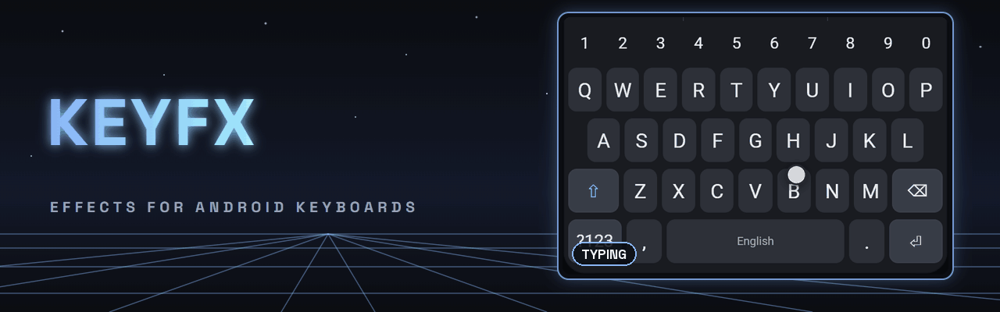
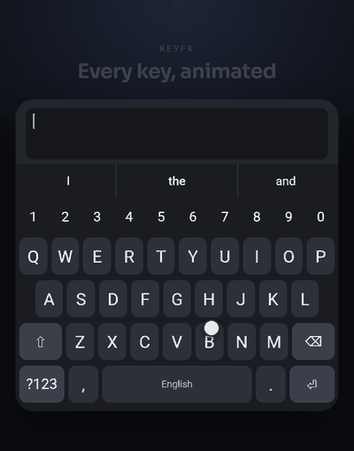
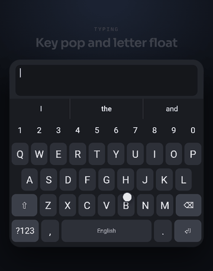
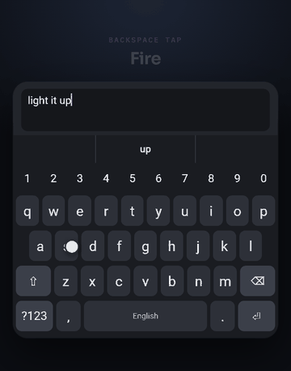
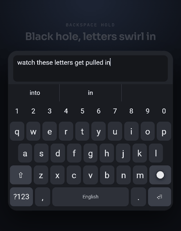
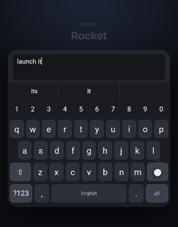
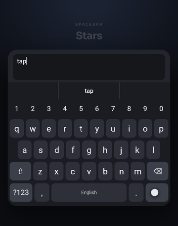
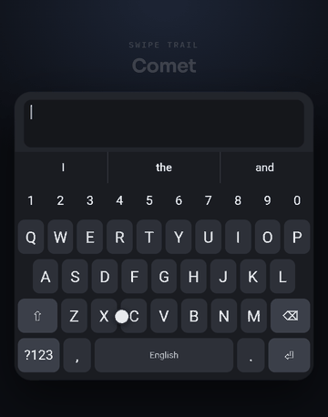
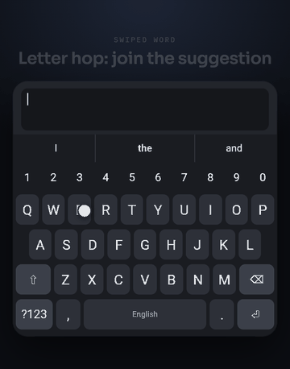
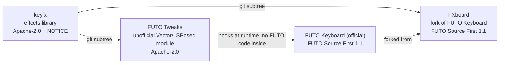

<p align="center">
  
</p>

# FXboard: an FX keyboard, a fork of FUTO Keyboard

[](https://github.com/Theo-Erickson/fxboard/releases/latest)
[](LICENSE.md)

> [!IMPORTANT]
> **Unofficial, work in progress.** FXboard is an unofficial, modified version of [FUTO Keyboard](https://github.com/futo-org/android-keyboard). It is not made, endorsed or supported by FUTO. The official FUTO Keyboard is at [github.com/futo-org/android-keyboard](https://github.com/futo-org/android-keyboard) and [keyboard.futo.tech](https://keyboard.futo.tech/).
>
> Please report problems with FXboard [here](https://github.com/Theo-Erickson/fxboard/issues), not to FUTO.

<table>
<tr>
<td width="46%"></td>
<td>

**FXboard is FUTO Keyboard with keyboard effects and a few typing extras.** It keeps everything FUTO Keyboard does (offline, private, swipe typing, voice input, predictions that learn on your phone) and adds keypress effects, a vertical spacebar cursor, and an option to hide the navigation bar. No root needed.

The clips are recorded in the [keyfx lab](https://theo-erickson.github.io/keyfx/), the browser version of FXboard's effects, with the same settings.

</td>
</tr>
</table>

## Contents

- [Summary](#summary)
- [Downloads](#downloads)
- [Install](#install)
- [What FXboard adds](#what-fxboard-adds)
- [See it in action](#see-it-in-action)
- [Related projects](#related-projects)
- [FAQ](#faq)
- [How FXboard follows the FUTO license](#how-fxboard-follows-the-futo-license)
- [Supporting the work](#supporting-the-work)
- [Building from source](#building-from-source)
- [Credits](#credits)

## Summary

FUTO Keyboard is a good modern keyboard that stays offline and doesn't spy on you. FXboard is a fork of it that adds [keyfx](https://github.com/Theo-Erickson/keyfx) effects and a few typing extras: key pops, floating letters, backspace fire and black holes, swipe trails, letter hop and more.

- **Everything FUTO Keyboard does**, unchanged: FXboard tracks FUTO's upstream code and adds to it.
- **All in two settings pages.** Everything FXboard adds lives in Settings under **FXboard extras** and **Keyboard effects**, where each effect can be switched off or tuned.
- **Installs alongside the official app** as its own app (`com.theo.fxboard`), so you can try it without removing FUTO Keyboard.
- **Free.** No ads, no paid features, no donation button in the app.

Have root and prefer to keep the official FUTO app? [FUTO Tweaks](https://github.com/Theo-Erickson/futo-tweaks) adds most of the same extras to it as an LSPosed / Vector module.

## Downloads

| | |
|---|---|
| **Latest APK** | [Releases page](https://github.com/Theo-Erickson/fxboard/releases/latest), file `fxboard-<version>-r<N>.apk` |
| **All versions** | [All releases](https://github.com/Theo-Erickson/fxboard/releases) |
| **Source** | `git clone --recursive https://github.com/Theo-Erickson/fxboard.git` (see [Building from source](#building-from-source)) |

Official FXboard builds only come from this repository's [Releases](https://github.com/Theo-Erickson/fxboard/releases). GitHub Actions builds each one from the commit it names. Each one is signed with this key:

```
SHA-256: D6:26:CA:25:99:B1:13:EA:7E:11:6B:D4:E3:3F:F9:CA:89:5C:B7:88:2A:EF:42:1C:2D:B0:BB:FF:D2:92:B5:2C
```

A keyboard sees everything you type, so please don't install FXboard APKs from anywhere else.

## Install

1. Download the APK from the [latest release](https://github.com/Theo-Erickson/fxboard/releases/latest) and open it. Allow your browser or file manager to install apps if Android asks.
2. Open **FXboard** from the app drawer and follow its setup to enable it as a keyboard.
3. Go to Settings > **FXboard extras** and Settings > **Keyboard effects**, and adjust what you like: most effects start on, and each can be switched off or tuned.

**Requirements:** Android 7.0 or newer. Hiding the navigation bar needs Android 15 or newer.

**Updating:** install the new APK over the old one. Every release is signed with the same key, so it updates in place and keeps your dictionary and settings.

## What FXboard adds

| Feature | What it does |
|---|---|
| Vertical spacebar cursor | Drag the spacebar up or down to move the cursor between lines, alongside the normal left and right drag |
| No navigation bar | Hide the keyboard navigation bar (down arrow and keyboard switcher), Android 15 and newer |
| Keyboard effects | Every [keyfx](https://github.com/Theo-Erickson/keyfx) effect, live on the keyboard: key pops that scale the real key, floating letters, swipe trails, letter hop with FUTO's exact swiped word, backspace effects that shake the key, ripple, sparks, water drops, a combo counter, lightning, neon and circuit trails, laser and vacuum backspace, piano, decode and flap show animations, a trackpad whose rails step with the cursor, and more |
| Keyboard effects page | Every effect setting, a **Preview** button on each effect that turns on only that one while you try it (everything comes back when you're done), an **Import** box for the keyfx lab's export, a reset button and a test field |

The spacebar cursor and navigation bar options are in Settings under **FXboard extras**; effects are under **Keyboard effects**.

**Coming next:** lighting up the predicted word in the suggestion bar, the bloom accent popup and the hide animation. You can try them today in the [keyfx lab](https://theo-erickson.github.io/keyfx/).

## See it in action

Recorded in the [keyfx lab](https://theo-erickson.github.io/keyfx/), the browser version of the effects FXboard draws, with the same settings; the lab's keyboard is a mock of FUTO Keyboard. Each clip runs through a few of the effects in its group. On the phone they're under Settings, **Keyboard effects**.

<table>
<tr>
<td align="center"><br><b>Typing</b>: key pop, letter float, heat streak, neighbor wave, sparks</td>
<td align="center"><br><b>Backspace tap</b>: fire, shatter, laser, disintegrate, glitch</td>
</tr>
<tr>
<td align="center"><br><b>Backspace hold</b>: black hole, portal, lava rumble</td>
<td align="center"><br><b>Enter</b>: rocket, shockwave, check mark, row wave</td>
</tr>
<tr>
<td align="center"><br><b>Spacebar</b>: stars, puff and shimmer, then drag it as a trackpad</td>
<td align="center"><br><b>Swipe trail</b>: comet, lightning, neon tube, ink brush, circuit</td>
</tr>
<tr>
<td align="center"><br><b>Swiped word</b>: letter hop three ways, and constellation</td>
</tr>
</table>

## Related projects

| Project | What it is | Pick it if... |
|---|---|---|
| **FXboard** (this repo) | An FX keyboard: a fork of FUTO Keyboard with the extras built in | you want effects with no root |
| [FUTO Tweaks](https://github.com/Theo-Erickson/futo-tweaks) | An unofficial LSPosed / Vector module that adds the effects to the official FUTO Keyboard app | you have root and want FUTO's official app and updates |
| [keyfx](https://github.com/Theo-Erickson/keyfx) | The effects library, and a browser lab for designing effect settings | you build keyboards, or want to try the effects in a browser |
| [FUTO Keyboard](https://keyboard.futo.org) (official) | The keyboard FXboard is forked from | you want the keyboard as FUTO ships it |



## FAQ

**Is FXboard made by FUTO?**
No. FXboard is an unofficial, modified version of FUTO Keyboard by Theo Erickson. It is not made, endorsed or supported by FUTO. Please report FXboard problems [here](https://github.com/Theo-Erickson/fxboard/issues), not to FUTO.

**Is it still offline and private?**
FXboard keeps FUTO Keyboard's privacy design and adds no analytics, ads or network features of its own. The effects run entirely on your phone.

**Can I keep the official FUTO Keyboard installed too?**
Yes. FXboard has its own app ID (`com.theo.fxboard`), so both install side by side. Your FUTO Keyboard dictionary and settings are not shared with FXboard.

**Do I need to pay for FUTO Keyboard features in FXboard?**
FUTO's own payment screens and reminders are left exactly as FUTO ships them, as FUTO's license requires. If you use FUTO Keyboard regularly, consider paying FUTO for it at [keyboard.futo.tech](https://keyboard.futo.tech/).

**How do updates from FUTO reach FXboard?**
The `master` branch mirrors FUTO's upstream exactly. FUTO's changes are merged into the `fxboard` branch, and each push there builds a new release. Version names start with the FUTO release they're based on, followed by `-r<N>`, the FXboard build number. For example, `0.1.30-r4` is FXboard build 4, based on FUTO Keyboard 0.1.30.

**Why isn't FXboard on Google Play or F-Droid?**
Not yet. For now, the GitHub Releases page is the only official source.

**Does FXboard take donations?**
No. FUTO's license allows modified versions only for non-commercial purposes, distributed free of charge, so FXboard has no donation button and takes no money. The effects library, keyfx, is a separate Apache-2.0 project and does take donations. See [Supporting the work](#supporting-the-work).

**Can I use the effects in my own keyboard?**
Yes. The effects are [keyfx](https://github.com/Theo-Erickson/keyfx), which is Apache-2.0 and keyboard-agnostic.

## How FXboard follows the FUTO license

FUTO Keyboard is licensed under the [FUTO Source First License 1.1](LICENSE.md), and FXboard as a whole is too. This is a plain reading of it, not legal advice.

- [x] **Non-commercial and free of charge:** FXboard is free, with no ads, no paid features and no donation button in the app. FXboard itself takes no donations.
- [x] **FUTO's payment features intact:** FUTO's payment screens and reminders are unchanged.
- [x] **FUTO's notices unaltered:** [LICENSE.md](LICENSE.md) and [NOTICE](NOTICE) are exactly as FUTO ships them.
- [x] **Modified version notice:** this README and the FXboard extras page say it is a modified, unofficial version.
- [x] **License terms shipped:** FUTO's license and notices come with the source, unchanged.
- [x] **No FUTO trademarks in the name:** the app is called FXboard. "A fork of FUTO Keyboard" only says where it comes from.

| Part | License |
|---|---|
| FXboard as a whole | FUTO Source First 1.1 |
| The `keyfx/` folder | Apache-2.0, with its own NOTICE |

## Supporting the work

FXboard itself takes no donations, and has no donation button in the app.

- **The effects:** FXboard's effects come from [keyfx](https://github.com/Theo-Erickson/keyfx), a separate, keyboard-agnostic library under Apache-2.0. If you want to support the effects work, you can do that on [keyfx's Ko-fi](https://ko-fi.com/theoerickson). Donations there fund keyfx, not FXboard.
- **The keyboard:** everything else in FXboard is FUTO's work. To support FUTO Keyboard, pay for it at [keyboard.futo.tech](https://keyboard.futo.tech/). FUTO's payment screens are still in FXboard, unchanged.

## Building from source

Clone with submodules (several live on gitlab.futo.org and huggingface, some in Git LFS), then build the FXboard flavor:

```bash
git clone --recursive https://github.com/Theo-Erickson/fxboard.git
cd fxboard
git submodule foreach --recursive 'git lfs pull || true'
./gradlew assembleFxboardRelease
```

You need JDK 21, the Android SDK and NDK `28.2.13676358`. The APK lands in `build/outputs/apk/fxboard/release/`.

| Branch | What it is |
|---|---|
| `fxboard` | FXboard: FUTO's code plus the extras. Releases build from here |
| `master` | An exact mirror of FUTO's upstream, used to merge FUTO's updates |

The GitHub Actions workflow in `.github/workflows/build-fxboard.yml` builds every pull request (the APK is attached to the run) and publishes a release for every push to `fxboard`.

### Recording the README media

The GIFs above are recorded with Readmotion from `tools/readmotion/`, playing keyfx's lab in its showcase mode from the `keyfx/` subtree. The effect gallery is shared with keyfx and FX for FUTO Keyboard (`keyfx/tools/readmotion/showcase.py`); `scenes.py` adds FXboard's hero. To record them again:

```
python tools/readmotion/scenes.py
readmotion-cli capture tools/readmotion/readmotion.json
readmotion-cli build tools/readmotion/readmotion.json
```

`scenes.py` writes the recordings into the config, so edit it rather than the steps in the JSON. `build` also writes full-size MP4s of every clip to `tools/readmotion/.work/full/`.

The hero is meant to end on a phone recording of FXboard's own Keyboard effects settings, which the lab can't show. That recording is still to do: [`tools/readmotion/phone/TODO.md`](tools/readmotion/phone/TODO.md) says what to record and how to add it.

### Where FXboard's code lives

| Path | What's in it |
|---|---|
| `java/fxboard/` | FXboard's resources overlay and its own code |
| `keyfx/` | The [keyfx](https://github.com/Theo-Erickson/keyfx) library, pulled in with `git subtree`. Fix effects upstream in keyfx |
| Everything else | FUTO Keyboard, with small marked changes where FXboard hooks in |

## Credits

FXboard is built on [FUTO Keyboard](https://keyboard.futo.tech/) by FUTO, itself a fork of [LatinIME](https://android.googlesource.com/platform/packages/inputmethods/LatinIME), the Android Open Source Project keyboard. All of FUTO's work stays under the [FUTO Source First License 1.1](LICENSE.md), with FUTO's [NOTICE](NOTICE) unchanged. For FUTO's own documentation, translations, layouts and official downloads, see [FUTO's README](https://github.com/futo-org/android-keyboard#readme).

FUTO and FUTO Keyboard are trademarks of FUTO Holdings, Inc. FXboard uses those names only to say what it is forked from. It claims no rights to them, and is not affiliated with, endorsed by or sponsored by FUTO.
