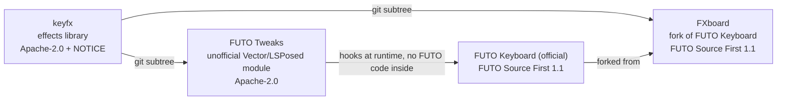

# FXboard: an FX keyboard, a fork of FUTO Keyboard

> **Work in progress.** FXboard is an unofficial, modified version of [FUTO Keyboard](https://github.com/futo-org/android-keyboard). It is not made, endorsed or supported by FUTO. The official FUTO Keyboard is at [github.com/futo-org/android-keyboard](https://github.com/futo-org/android-keyboard) and [keyboard.futo.tech](https://keyboard.futo.tech/).
>
> Please report problems with FXboard here, not to FUTO.

FXboard is FUTO Keyboard with keyboard effects and a few typing extras. It keeps everything FUTO Keyboard does, offline and private, and adds:

- **Vertical spacebar cursor:** drag the spacebar up or down to move the cursor between lines, alongside the normal left and right drag.
- **No navigation bar:** an option to hide the keyboard navigation bar (down arrow and keyboard switcher) on Android 15 and newer.
- **Keypress effects:** ripple, key glow, particles and a spacebar drag trail. These are being replaced by [keyfx](https://github.com/Theo-Erickson/keyfx), which brings key pops, floating letters, backspace effects, swipe trails, letter hop, hold charge and show and hide animations.

Everything FXboard adds lives in Settings, under **FXboard extras**, and every effect starts off.

FXboard installs alongside official FUTO Keyboard, as its own app (`com.theo.fxboard`).

## Download

Official FXboard builds only come from this repository's [Releases](https://github.com/Theo-Erickson/fxboard/releases). Each one is signed with this key:

```
SHA-256: D6:26:CA:25:99:B1:13:EA:7E:11:6B:D4:E3:3F:F9:CA:89:5C:B7:88:2A:EF:42:1C:2D:B0:BB:FF:D2:92:B5:2C
```

## How FXboard follows the FUTO license

FUTO Keyboard is licensed under the [FUTO Source First License 1.1](LICENSE.md), and FXboard as a whole is too. This is a plain reading of it, not legal advice.

- [x] **Non-commercial and free of charge:** FXboard is free, with no ads, no paid features and no donation button in the app.
- [x] **FUTO's payment features intact:** FUTO's payment screens and reminders are unchanged.
- [x] **FUTO's notices unaltered:** [LICENSE.md](LICENSE.md) and [NOTICE](NOTICE) are exactly as FUTO ships them.
- [x] **Modified version notice:** this README and the FXboard extras page say it is a modified, unofficial version.
- [x] **License terms shipped:** FUTO's license and notices come with the source, unchanged.
- [x] **No FUTO trademarks in the name:** the app is called FXboard. "A fork of FUTO Keyboard" only says where it comes from.

## The projects



| Project | What it is | License |
|---|---|---|
| [keyfx](https://github.com/Theo-Erickson/keyfx) | The keyboard effects library | Apache-2.0, with NOTICE |
| [FUTO Tweaks](https://github.com/Theo-Erickson/futo-tweaks) | An unofficial Vector / LSPosed module that adds the same effects to the official FUTO Keyboard app | Apache-2.0 |
| FXboard | This fork | FUTO Source First 1.1. The `keyfx/` folder inside it keeps its own Apache-2.0 license and NOTICE. |

## Supporting the work

FXboard has no donation button, and won't get one. If you want to support the effects work, you can do that on [keyfx's Ko-fi](https://ko-fi.com/theoerickson).

## Building

Clone with submodules (several live on gitlab.futo.org and huggingface), then build the FXboard flavor:

```
git clone --recursive https://github.com/Theo-Erickson/fxboard.git
./gradlew assembleFxboardRelease
```

The GitHub Actions workflow in `.github/workflows/build-fxboard.yml` builds every pull request and publishes a release for every push to the `fxboard` branch. `master` mirrors FUTO's upstream exactly.

---

# The original FUTO Keyboard README

The goal is to make a good modern keyboard that stays offline and doesn't spy on you. This keyboard is a fork of [LatinIME, The Android Open-Source Keyboard](https://android.googlesource.com/platform/packages/inputmethods/LatinIME), with significant changes made to it.

Check out the [FUTO Keyboard website](https://keyboard.futo.tech/) for downloads and more information.

The code is licensed under the [FUTO Source First License 1.1](LICENSE.md).

## Issue tracking and contributing

Please check the GitHub repository to report issues: [https://github.com/futo-org/android-keyboard/](https://github.com/futo-org/android-keyboard/)

The source code is hosted on our [internal GitLab](https://gitlab.futo.org/keyboard/latinime) and mirrored to [GitHub](https://github.com/futo-org/android-keyboard/). As registration is closed on our internal GitLab, we use GitHub instead for issues and pull requests.

If you want to help translate the app, please do so via our Pontoon instance: https://i18n-keyboard.futo.org/

Due to custom license, pull requests to this repository require signing a [CLA](https://cla.futo.org/) which you can do after opening a PR. Contributions to the [layouts repo](https://github.com/futo-org/futo-keyboard-layouts) don't require CLA as they're Apache-2.0

Please do not submit AI-generated pull requests, as these tend to make the codebase more difficult to understand. Pull requests made with clear heavy use of AI may be closed without comment. Please also avoid using AI to write issues, and try to explain it in your own words instead.

## Layouts

If you want to contribute layouts, check out the [layouts repo](https://github.com/futo-org/futo-keyboard-layouts).

## Building

When cloning the repository, you must perform a recursive clone to fetch all dependencies:
```
git clone --recursive https://gitlab.futo.org/keyboard/latinime.git
```

If you forgot to specify recursive clone, use this to fetch submodules:
```
git submodule update --init --recursive
```

You can then open the project in Android Studio and build it that way, or use gradle commands:
```
./gradlew assembleUnstableDebug
./gradlew assembleStableRelease
```

## APK signing

For official FUTO Keyboard versions, you can verify the APK's signing key fingerprint for integrity.

```
Signing key fingerprint for all versions except Google Play:

MD5: 3A:BB:71:C6:BB:E4:92:27:B1:E3:5D:81:01:48:6A:B0
SHA1: 5D:15:B3:6E:C9:6A:96:28:41:09:DD:62:93:0D:9C:39:9F:5F:06:43
SHA-256: 74:3F:AD:58:64:AB:C4:26:50:0B:2D:C2:C4:7C:8A:D3:24:CB:CD:16:03:3F:80:16:99:48:41:35:63:74:F9:95

```
